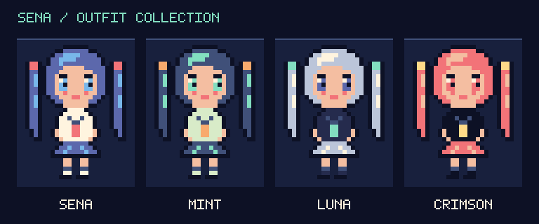

# 躲避作业：Pyxel 学习项目

## 成品版：Midnight Study Club

在夜晚的教室里躲避作业、选择技能组合，反击期末院长，通关并解锁新外观。

**双击 `play.command` 开始玩。** 也可以在项目目录运行 `./play.command`。

**快速展示：双击 `demo.command`。高难 Boss：双击 `boss.command`。** [一分钟演示步骤](docs/showcase.md)

主角是原创 Q 版校园少女 **星奈 SENA**：蓝紫双马尾、水手服与红色领结，有眨眼、步行和冲刺表情。




- 原创像素角色、夜景教室、走路动画、粒子效果和芯片音乐。
- 三颗生命、冲刺冷却、护盾道具、受伤保护和掉落预告。
- 三次三选一升级，七种能力可以组合，改变冲刺、护盾、收集与反击。
- 真实生命条的三阶段 Boss、答案弹反击、倒计时、通关与评级。
- 普通冒险、轻松冒险、直接高难 Boss，以及快速展示四种模式。
- 四套原创配色外观，通过收集笔记、通关和高难通关解锁。
- 开始画面、衣橱、暂停、重开、静音，以及本机成绩和成就存档。
- 完整通关链路：三次升级 → 三阶段 Boss → 胜利结算 → 剧情结局；失败可立即重试。
- 游戏内中英文实时切换，语言偏好随本机存档保存；内置开源中文字库。
- 完整代码在 `game/`；原有课程仍可按下表独立启动。

| 按键 | 操作 |
| --- | --- |
| 标题画面 1 / 2 / 3 / D | 普通冒险 / 轻松冒险 / 高难 Boss / 快速展示 |
| 标题或结束画面 C | 打开衣橱，1～4 预览，Enter 装备 |
| 标题画面 S | 切换可用外观 |
| 空格 / Enter | 开始 |
| ← / → 或 A / D | 移动 |
| 游戏中空格 | 沿当前朝向冲刺，冲刺期间可穿过作业 |
| Boss 战按住 Z | 发射答案弹反击，尽量保持在 Boss 下方 |
| 能力选择时 1 / 2 / 3 | 选一项升级；也支持方向键加 Enter |
| 展示模式 N | 推进至下一次升级，三项选完后进入 Boss |
| P / Esc | 暂停或继续 |
| M | 音乐与音效开关 |
| L | 随时切换中文 / English；重启后保留选择 |
| 结束后 R / 空格 | 再来一局 |
| 胜利结算 Enter | 阅读结局；结局画面 Enter 返回主菜单 |
| 失败结算或暂停 Enter | 返回主菜单 |
| Q | 保存并退出 |

第一次体验可以按 **2 → 空格**，从轻松模式开始。

通关路线：普通/轻松模式存活到第 **20、40、60 秒**各选择一项能力；第 **90 秒**进入期末院长战。按住 **Z** 持续反击，在倒计时归零前打空 Boss 生命值。胜利后查看成绩、解锁内容，再按 **Enter** 看结局。高难模式会直接进入三项能力选择和 Boss 战；展示模式可按 **N** 快速推进。

[完整玩法与后续学习路线](docs/finished-game.md) · [版本记录](CHANGELOG.md)

[玩法路线图](docs/gameplay-roadmap.md) · [快速展示与高难参数](docs/showcase.md)

## 选择课程

按顺序学习，每课都保留独立代码与启动文件。

| 课程 | 内容 | 代码 | 双击启动 | 学习说明 |
| --- | --- | --- | --- | --- |
| 第 1 课 | 角色移动、参数与坐标 | `lessons/lesson_01.py` | `start.command` | [第一课](docs/lesson-01.md) |
| 第 2 课 | 随机数、列表与作业雨 | `lessons/lesson_02.py` | `start-lesson-02.command` | [第二课](docs/lesson-02.md) |
| 第 3 课 | 开始、碰撞、计分与重开 | `lessons/lesson_03.py` | `start-lesson-03.command` | [第三课](docs/lesson-03.md) |

也可以在项目目录运行对应启动文件，如 `./start-lesson-02.command`。

点击游戏窗口后，按 ← / → 移动，按 Q 退出。第三课按空格开始，碰撞结束后按 R 重开。

保存代码后，关闭游戏并重新启动，修改才会生效。

第一课练习完成后的角色参数（速度 4、颜色 8、尺寸 12）已沿用到第二、第三课。每课是独立程序，修改第二课不会自动修改第三课。

用 [Git 使用说明](docs/version-control.md) 保存每次练习。

## 环境

Python 3.11 以上，Pyxel 固定为 2.9.9。此项目使用自己的 `.venv`。

在新的电脑上，可以用已安装的 Python 3.11 以上版本创建环境：

```sh
python3.12 -m venv .venv
.venv/bin/python -m pip install -r requirements.txt
./play.command
```

## 后续学习

可以从 `game/config.py` 的参数开始，再读 `upgrades.py`、`boss.py` 和 `progression.py`，按 [学习路线](docs/finished-game.md) 逐步理解完整玩法。

## 官方参考

- [Pyxel 项目](https://github.com/kitao/pyxel)
- [用户指南](https://kitao.github.io/pyxel/web/user-guide/)
- [API 文档](https://kitao.github.io/pyxel/web/api-reference/)
- [官方示例](https://kitao.github.io/pyxel/web/showcase/)

本项目的教学代码是为本次学习编写的。

游戏中文字使用 [Noto Sans CJK SC](https://github.com/notofonts/noto-cjk) 的精简字体，依 [SIL Open Font License 1.1](assets/fonts/OFL.txt) 随项目分发；不依赖 macOS 系统字体。

若以后在 `game/i18n.py` 增加新的中文字，先从官方仓库取得 `NotoSansCJKsc-Regular.otf`，在构建环境安装 `fonttools`，然后运行 `.venv/bin/python -m tools.build_font /path/to/NotoSansCJKsc-Regular.otf` 更新精简字库。运行游戏本身只需 `requirements.txt` 中的 Pyxel。
