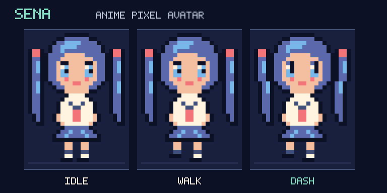

# 躲避作业：Pyxel 学习项目

## 成品版：Midnight Study Club

在夜晚的教室里躲避从天而降的作业，收集笔记与护盾，冲刺穿过危险，争取新的最高分。

**双击 `play.command` 开始玩。** 也可以在项目目录运行 `./play.command`。

主角是原创 Q 版校园少女 **星奈 SENA**：蓝紫双马尾、水手服与红色领结，有眨眼、步行和冲刺表情。



- 原创像素角色、夜景教室、走路动画、粒子效果和芯片音乐。
- 三颗生命、冲刺冷却、护盾道具、受伤保护和掉落预告。
- 八档逐渐提升的难度，普通与轻松模式分别记录最高分。
- 开始画面、暂停、重开、静音，以及本机自动存档。
- 完整代码在 `game/`；原有课程仍可按下表独立启动。

| 按键 | 操作 |
| --- | --- |
| 标题画面 1 / 2 | 普通模式 ARCADE / 轻松模式 COZY |
| 空格 / Enter | 开始 |
| ← / → 或 A / D | 移动 |
| 游戏中空格 | 沿当前朝向冲刺，冲刺期间可穿过作业 |
| P / Esc | 暂停或继续 |
| M | 音乐与音效开关 |
| 结束后 R / 空格 | 再来一局 |
| 暂停或结束后 Enter | 返回主菜单 |
| Q | 保存并退出 |

第一次体验可以按 **2 → 空格**，从轻松模式开始。

[完整玩法与后续学习路线](docs/finished-game.md) · [版本记录](CHANGELOG.md)

[下一版玩法设计建议](docs/gameplay-roadmap.md)：局内三选一升级、期末 Boss、擦弹连击和外观解锁。

## 选择课程

按顺序学习，每课都保留独立代码与启动文件。

| 课程 | 内容 | 代码 | 双击启动 | 学习说明 |
| --- | --- | --- | --- | --- |
| 第 1 课 | 角色移动、参数与坐标 | `lessons/lesson_01.py` | `start.command` | [第一课](docs/lesson-01.md) |
| 第 2 课 | 随机数、列表与作业雨 | `lessons/lesson_02.py` | `start-lesson-02.command` | [第二课](docs/lesson-02.md) |
| 第 3 课 | 开始、碰撞、计分与重开 | `lessons/lesson_03.py` | `start-lesson-03.command` | [第三课](docs/lesson-03.md) |

也可以在项目目录运行对应启动文件，如 `./start-lesson-02.command`。

点击游戏窗口后，按 ← / → 移动，按 Q 退出。第三课按空格开始，碰撞结束后按 R 重开。

保存代码后，关闭游戏并重新启动，修改才会生效。

第一课练习完成后的角色参数（速度 4、颜色 8、尺寸 12）已沿用到第二、第三课。每课是独立程序，修改第二课不会自动修改第三课。

用 [Git 使用说明](docs/version-control.md) 保存每次练习。

## 环境

Python 3.11 以上，Pyxel 固定为 2.9.9。此项目使用自己的 `.venv`。

在新的电脑上，可以用已安装的 Python 3.11 以上版本创建环境：

```sh
python3.12 -m venv .venv
.venv/bin/python -m pip install -r requirements.txt
./play.command
```

## 后续学习

成品版已实现难度递进、像素角色、音效、护盾与最高分。可以从 `game/config.py` 的参数开始，按 [学习路线](docs/finished-game.md) 逐步理解这些功能。

## 官方参考

- [Pyxel 项目](https://github.com/kitao/pyxel)
- [用户指南](https://kitao.github.io/pyxel/web/user-guide/)
- [API 文档](https://kitao.github.io/pyxel/web/api-reference/)
- [官方示例](https://kitao.github.io/pyxel/web/showcase/)

本项目的教学代码是为本次学习编写的。
