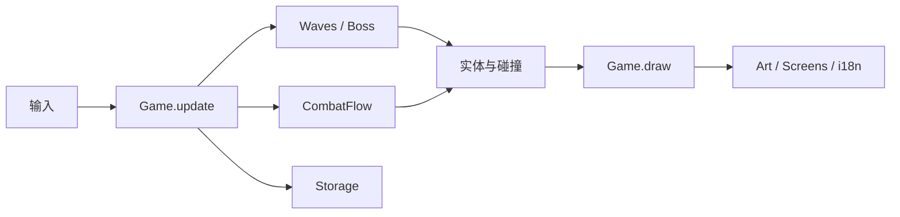

# Midnight Study Club｜客户端开发作品集说明

**一句话介绍：** 320 × 240 的原创像素动作游戏。玩家操纵星奈在夜间教室中躲避并击碎作业，通过三次能力选择组成打法，最后击败有三阶段攻击的期末院长。

## 面试时展示什么

1. 双击 `demo.command`，在标题画面按 `H` 展示新手引导，再按 `Enter` 返回。
2. 按空格开始，展示移动、冲刺和按住 `Z` 射击。主动击碎作业、擦险和冲刺会提高连击与专注。
3. 按 `N` 快速推进三次能力选择，说明每张卡如何改变实际战斗逻辑。
4. 进入 Boss 战，说明点名、双侧夹击和移动缺口的预告与逃生空间。专注满格后按 `X` 清场并造成伤害。
5. 展示结算页的成绩、连击、击碎数量和能力组合。按 `Enter` 展示结局；按 `L` 切换中英文。

若要复现同一批随机出招，可在项目目录执行：

```sh
.venv/bin/python -m game.main --showcase --seed 42
```

输入时机仍由操作者控制，因此相同种子会固定随机选择的序列，演示中的决策也应保持一致。

## 技术拆解

| 模块 | 面试可讲的实现选择 |
| --- | --- |
| `game/main.py` | 固定帧率主循环、状态切换、实体生命周期、碰撞与场景绘制 |
| `game/waves.py` | 按波次编排单发、双侧夹击和错时三连，预告先于碰撞生效 |
| `game/combat.py` | 与画面独立的连击、倍率、专注资源及超时衰减规则 |
| `game/boss.py` | 血量驱动的三阶段切换、倒计时和有安全缺口的攻击规划 |
| `game/upgrades.py` | 数据驱动的能力池；角色、道具和 Boss 逻辑消费已选能力 |
| `game/i18n.py` | 运行时中英文切换及字体测宽；精简中文字形随游戏分发 |
| `game/storage.py` | 旧档兼容、原子写入与成绩/成就/语言偏好持久化 |



## 设计取舍

- **可读的难度：** 危险物先显示下落预告，后进入碰撞判定。组合攻击在横向保留移动空间，Boss 换阶段时清除旧攻击并重新给准备时间。
- **主动风险与奖励：** 躲避可以保命；射击、擦险和冲刺可以积累连击与专注。受伤会中断连击并损失部分专注。
- **短时展示与完整流程共存：** 正式冒险需要存活 90 秒并进行三次能力选择；展示模式可用 `N` 快速走到相同的 Boss、结算和结局路径。
- **可解释的资源成本：** 画面、角色与音效主要由代码绘制；中文字体子集约 130 KB，来源和许可记录在 README。

## 参考与原创范围

- [Pyxel 官方 Shooter 示例](https://github.com/kitao/pyxel/blob/main/python/pyxel/examples/09_shooter.py)：参考清晰的场景切换、实体更新和击中反馈组织方式。
- [Pyxel 官方用户指南与 Showcase](https://github.com/kitao/pyxel/blob/main/docs/user-guide.md)：参考短时可玩样例和可分享演示的呈现方式。
- [Pixhell 项目](https://github.com/CS362-Team12/Pixhell)：参考成长选择与 Boss 作为阶段目标的作品集叙述方式。

角色、教室、能力、Boss 攻击和音乐由本项目自行编写；未复制上述项目的素材或源码。中文字体使用 Noto Sans CJK SC 的 SIL OFL 授权子集。

## 投递时的说明

这是一个 **Pyxel/Python 原型**，适合展示玩法落地、状态管理、战斗反馈和迭代能力。针对客户端开发岗位，后续可以把同一战斗系统移植到目标岗位常用的引擎与语言，并在作品集中展示两版的架构与性能取舍。

项目由你与 Codex 协作迭代。投递材料请准确写明你亲自完成的设计、代码、调参与验证内容；录制一段你能独立讲解的实际游玩视频会比堆砌功能列表更有说服力。
